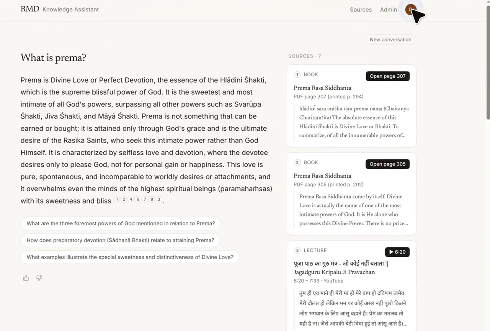

# rmdLLM

Devotees ask natural-language questions about spiritual teachings and scripture; answers are grounded
in cited source material (scanned books and Hindi lecture transcripts) — never invented.

- Architecture & data model: [docs/ARCHITECTURE.md](docs/ARCHITECTURE.md)
- API: `apps/api` (FastAPI, SQLAlchemy, Alembic, pgvector)
- Web: `apps/web` (Next.js 14, TypeScript, Tailwind)

## Demo

Live staging: https://rmdllm.krishchaudhary.me

Guest question → create account → chat saved to the account → follow-ups → reload → rename/delete → sign out → delete all → delete account → mobile:

[](docs/demo/accounts-demo.mp4)

▶ [Watch the demo (3½ min)](docs/demo/accounts-demo.mp4)

## Quick start
```
cp .env.example .env
make up            # postgres(pgvector) + redis via docker compose
cd apps/api && uv venv .venv && uv pip install -e ".[dev]" && cd ../..
make migrate && make api
cd apps/web && pnpm install && pnpm dev
```
Run checks with `make test` and `make lint`.
